# 🛒 FreshNest – Grocery Delivery System

A full-stack **Grocery Delivery Web Application** built with React.js, Java 21, Spring Boot, and MySQL.

FreshNest makes online grocery shopping convenient. Customers can browse grocery products, manage shopping carts, place orders, select payment methods, and view order details. Administrators can manage products, process orders, and generate reports.

---

## 🚀 Project Overview

FreshNest provides a platform for customers to purchase grocery products online through a responsive web interface.

### Main Components

- **Frontend:** React.js
- **Backend:** Java 21 and Spring Boot
- **Database:** MySQL
- **API Communication:** REST APIs using Axios
- **Version Control:** Git and GitHub

The application provides separate customer and admin functionality for grocery shopping and order management.

---

## ✨ Key Features

### 🔐 Authentication and Security

- User Registration and Login
- JWT-Based Authentication
- Role-Based Access Control
- Protected Routes
- Password Hashing
- Authenticated API Requests

### 🛍️ Customer Module

Customers can:

- View the Home Page
- Browse Grocery Products
- View Product Details
- Add Products to the Shopping Cart
- Update Product Quantities
- Remove Products from the Cart
- View the Cart Summary
- Proceed to Checkout
- Select Cash on Delivery or Online Payment
- View a UPI QR Code for Online Payment
- Place Grocery Orders
- View My Orders
- View Order Details
- Manage Their Profile
- Manage Delivery Information

### 👨‍💼 Admin Module

Administrators can:

- Access the Admin Dashboard
- View Dashboard Statistics
- Add, Edit, and Manage Grocery Products
- View Customer Orders
- Manage Order Processing
- View Reports
- Generate and Download PDF Reports

### 💳 Payment Options

- Cash on Delivery (COD)
- Online Payment using a UPI QR Code
- Payment Status Handling Through Backend APIs

> **Note:** Displaying a QR code alone does not confirm that payment was received. Actual payment verification requires a trusted backend payment integration.

### 🎨 User Interface

- FreshNest Branding
- Green and White Theme
- Responsive React Interface
- User-Friendly Navigation
- Dedicated Customer and Admin Pages
- Shopping Cart and Checkout Pages
- Order History and Order Details
- Customer Profile Management

---

## 🛠️ Technology Stack

### Frontend

- React.js
- JavaScript
- HTML5
- CSS3
- Axios
- React Router

### Backend

- Java 21
- Spring Boot 3.5.4
- Spring Web
- Spring Data JPA
- Spring Security
- JWT Authentication
- Maven
- REST APIs

### Database

- MySQL 8

### Development Tools

- Visual Studio Code
- MySQL Workbench
- Postman
- Git
- GitHub
- Node.js and npm

---

## 🔄 Application Flow

### Customer Flow

```text
Guest Home Page
       |
       v
Login / Register
       |
       v
Customer Home Page
       |
       v
Browse Grocery Products
       |
       v
Add Products to Cart
       |
       v
Review Shopping Cart
       |
       v
Checkout
       |
       v
Select Payment Method
       |
       +-------------------+
       |                   |
       v                   v
Cash on Delivery      Online Payment
       |                   |
       v                   v
Place COD Order       Display UPI QR Code
                           |
                           v
                      Complete Payment
                           |
                           v
                   Backend Payment Verification
       |                   |
       +-------------------+
                 |
                 v
              My Orders
                 |
                 v
           Order Details
```

### Admin Flow

```text
Admin Login
     |
     v
Admin Dashboard
     |
     +---- Product Management
     |
     +---- Order Management
     |
     +---- Reports
              |
              v
           PDF Export
```

---

## 👥 User Roles

### ADMIN

- Access the Admin Dashboard
- Manage Grocery Products
- View Customer Orders
- Manage Order Processing
- View Reports
- Generate PDF Reports

### CUSTOMER

- Register and Log In
- Browse Grocery Products
- Manage Shopping Cart
- Place Orders
- Select Payment Methods
- View Order History
- View Order Details
- Manage Profile and Delivery Information

---

## 🏗️ Project Architecture

FreshNest uses a full-stack architecture in which the frontend communicates with the backend through REST APIs.

```text
       FreshNest Grocery Delivery
                   |
                   v
            React Frontend
                   |
              Axios / HTTP
                   |
                   v
          Spring Boot REST API
                   |
           Spring Security + JWT
                   |
                   v
             Spring Data JPA
                   |
                   v
              MySQL Database
```

The React frontend handles the user interface and API requests. The Spring Boot backend manages application logic, authentication, authorization, and database operations. MySQL stores application data.

---

## 📂 Project Structure

```text
Grocery-Delivery-System/
│
├── backend/
│   ├── pom.xml
│   └── src/
│       └── main/
│           ├── java/
│           └── resources/
│               └── application.properties
│
├── frontend/
│   ├── public/
│   ├── src/
│   │   ├── components/
│   │   ├── context/
│   │   ├── images/
│   │   ├── pages/
│   │   │   ├── admin/
│   │   │   └── user/
│   │   ├── services/
│   │   ├── styles/
│   │   ├── App.js
│   │   └── index.js
│   └── package.json
│
├── screenshot/
│   ├── 01.Guest_Page.jpeg
│   ├── 02.Login_Page.jpeg
│   ├── 03.Create_Account.jpeg
│   ├── 04.Admin_Dashboard.jpeg
│   ├── 05.Admin_Products.jpeg
│   ├── 06.Admin_Orders.jpeg
│   ├── 07.Admin_Reports.jpeg
│   ├── 08.Report_Pdf.jpeg
│   ├── 09.User_Home.jpeg
│   ├── 10.User_Products.jpeg
│   ├── 11.My_Cart.jpeg
│   ├── 12.Checkout.jpeg
│   ├── 13.Order_Details.jpeg
│   ├── 14.My_Orders.jpeg
│   └── 15.My_Profile.jpeg
│
├── .gitignore
└── README.md
```

> **Note:** This is a representative structure. Your actual files and package names may differ. Update the screenshot filenames if they differ from your actual files.

---

## 🗄️ Database Overview

FreshNest uses MySQL to store and manage application data.

Depending on the implemented backend entities, the database may include tables for:

- Users
- Products
- Addresses
- Shopping Carts
- Cart Items
- Orders
- Order Items
- Payments
- Reviews

The actual database schema and relationships are defined by the backend entity classes and database configuration.

---

## 🔌 Backend API

### Base URL

```text
http://localhost:8080/api
```

### API Modules

| Module | Operations |
|---|---|
| Authentication | Registration and login |
| Products | Browse and manage products |
| Cart | Add, update, and remove cart items |
| Checkout | Submit checkout requests |
| Orders | Place orders and view order details |
| Profile | View and update profile information |
| Admin | Manage products and orders |
| Reports | View and export reports |
| Payments | Handle payment status and verification |

The exact endpoints depend on the controllers implemented in the backend.

---

## 🔐 JWT Authentication Flow

```text
User Enters Login Credentials
              |
              v
Frontend Sends Login Request
              |
              v
Backend Validates Credentials
              |
              v
Backend Generates JWT
              |
              v
Frontend Receives Authentication Response
              |
              v
Token Added to API Requests
              |
              v
Backend Validates Token
              |
              v
Authorized Access to Protected Resources
```

Passwords should be stored as secure hashes, and protected backend endpoints should enforce the appropriate role-based permissions.

---

## ⚙️ Prerequisites

Install the following software before running the application:

- Java Development Kit (JDK) 21
- Node.js and npm
- MySQL Server
- Git
- Visual Studio Code

### Verify Installations

Run these commands in your terminal:

```bash
java -version
node -v
npm -v
git --version
```

---

## ▶️ How to Run the Project

### 1. Open the Project

Open the `Grocery-Delivery-System` folder in Visual Studio Code.

### 2. Configure MySQL

Start your MySQL server and create the database matching the name configured in your backend.

For example, if your application uses `grocery_delivery_db`:

```sql
CREATE DATABASE grocery_delivery_db;
```

Use the exact database name specified in `backend/src/main/resources/application.properties`.

### 3. Configure the Backend

Open:

```text
backend/src/main/resources/application.properties
```

Configure your MySQL URL, username, password, and JWT settings according to your backend implementation.

**Important:** Do not upload real database passwords or JWT signing secrets to GitHub.

### 4. Start the Spring Boot Backend

Open a terminal in VS Code:

```bat
cd backend
mvnw.cmd spring-boot:run
```

If the Maven wrapper is unavailable but Maven is installed, use:

```bash
mvn spring-boot:run
```

The backend commonly runs at:

[http://localhost:8080](http://localhost:8080)

Check the startup log for the actual port and confirm that the database connection succeeds.

### 5. Start the React Frontend

Open a second terminal in VS Code:

```bash
cd frontend
npm install
npm start
```

If the frontend uses Create React App, it commonly runs at:

[http://localhost:3000](http://localhost:3000)

Check `frontend/src/services/api.js` to ensure the frontend API URL matches your backend configuration.

Keep both terminals running while using the application.

---

## 📸 Application Screenshots

The screenshots below use GitHub-compatible Markdown image syntax. They will display when the corresponding image files exist in the repository at the specified paths.

### 1. Guest Home Page

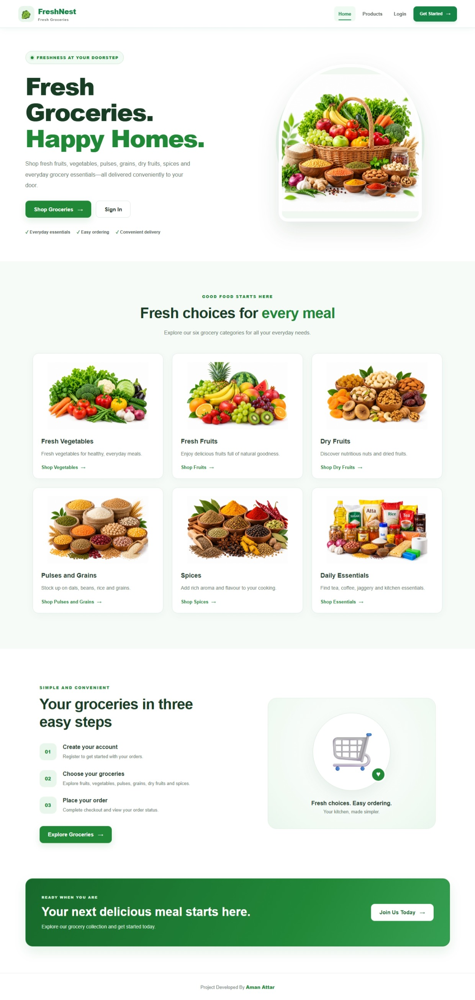

### 2. Login Page

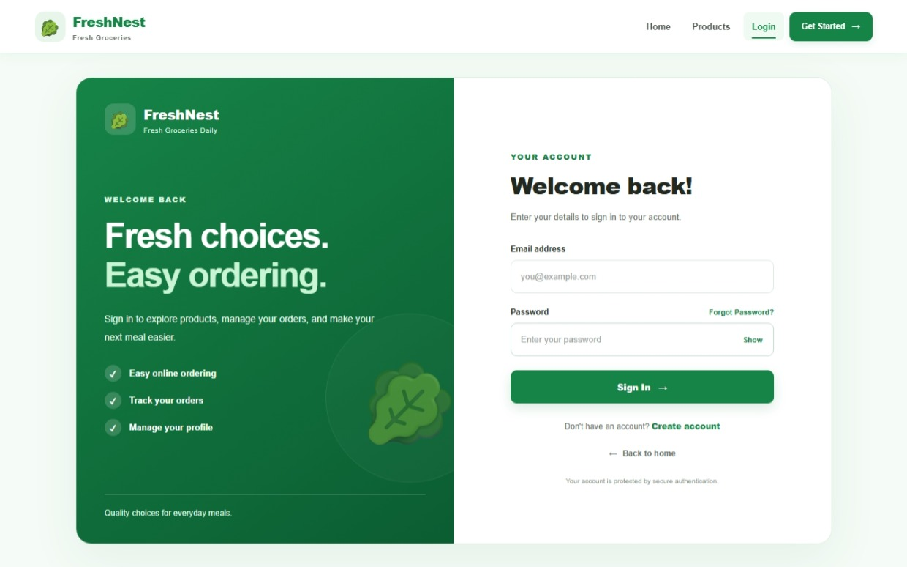

### 3. Create Account

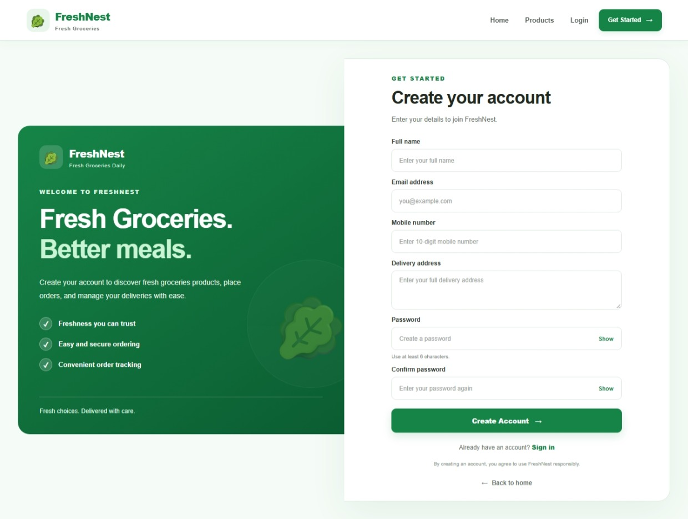

### 4. Admin Dashboard

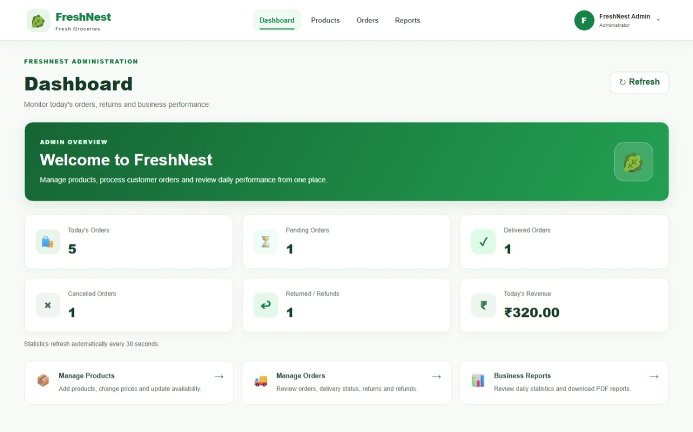

### 5. Admin Products

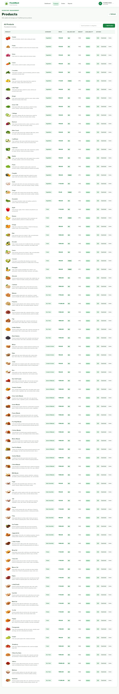

### 6. Admin Orders

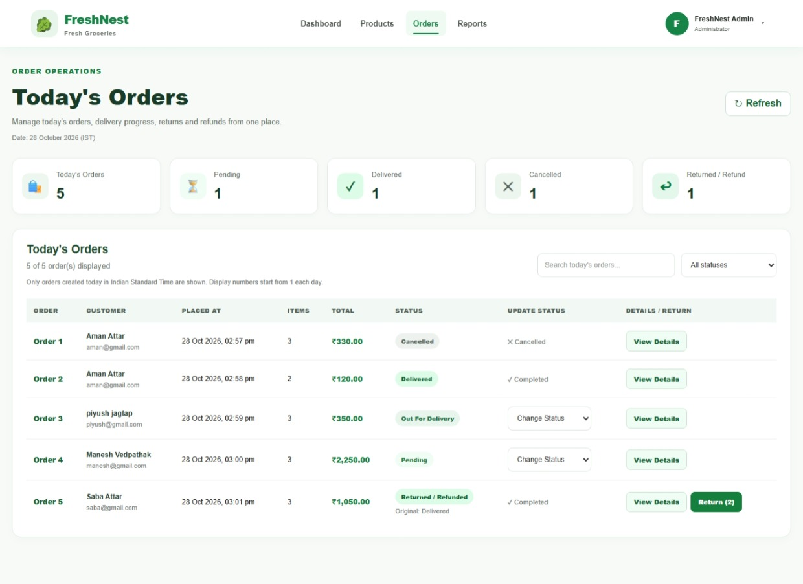

### 7. Admin Reports

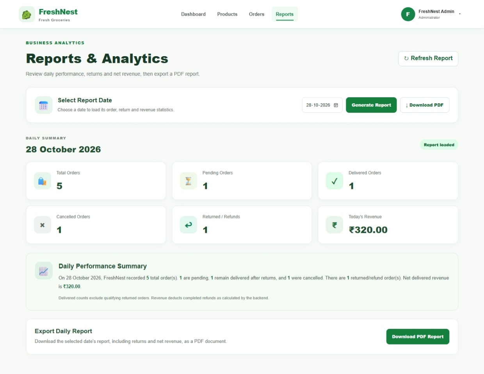

### 8. PDF Report

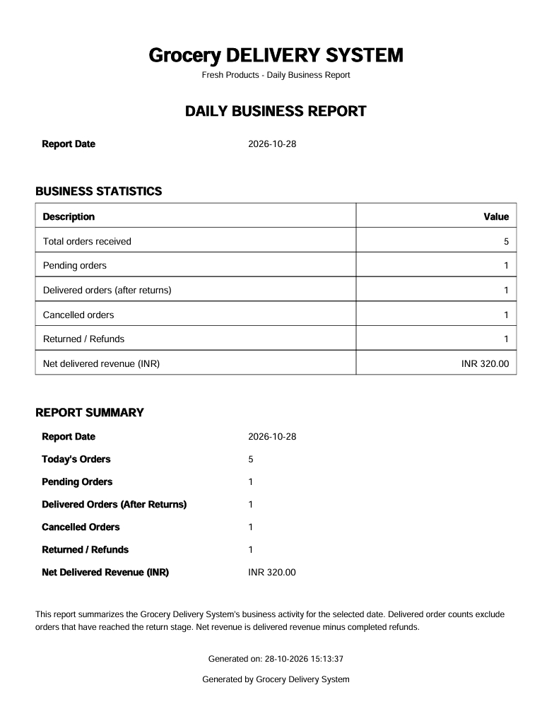

### 9. Customer Home Page

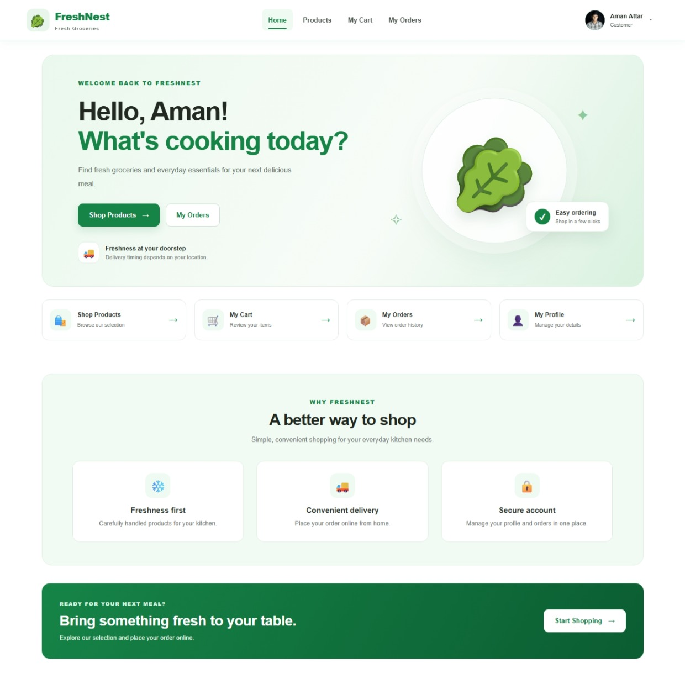

### 10. Grocery Products

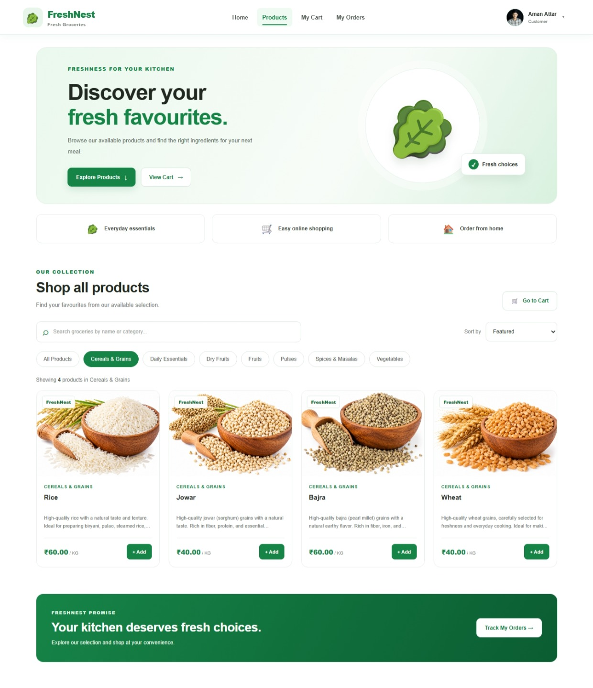

### 11. Shopping Cart

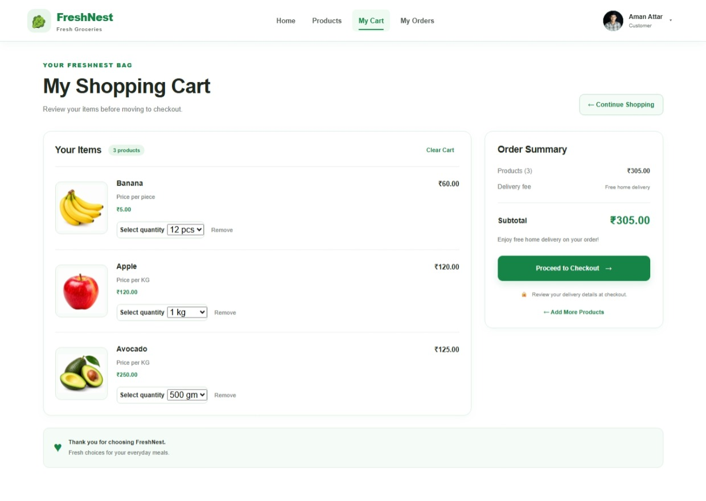

### 12. Checkout Page

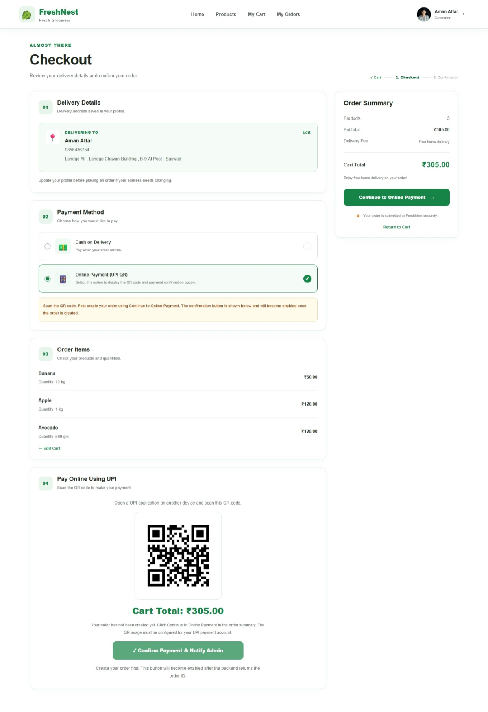

### 13. Order Details

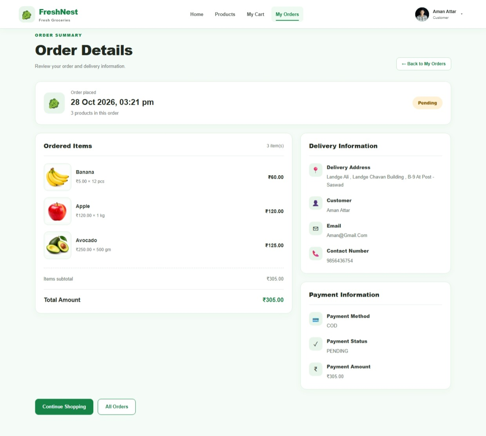

### 14. My Orders

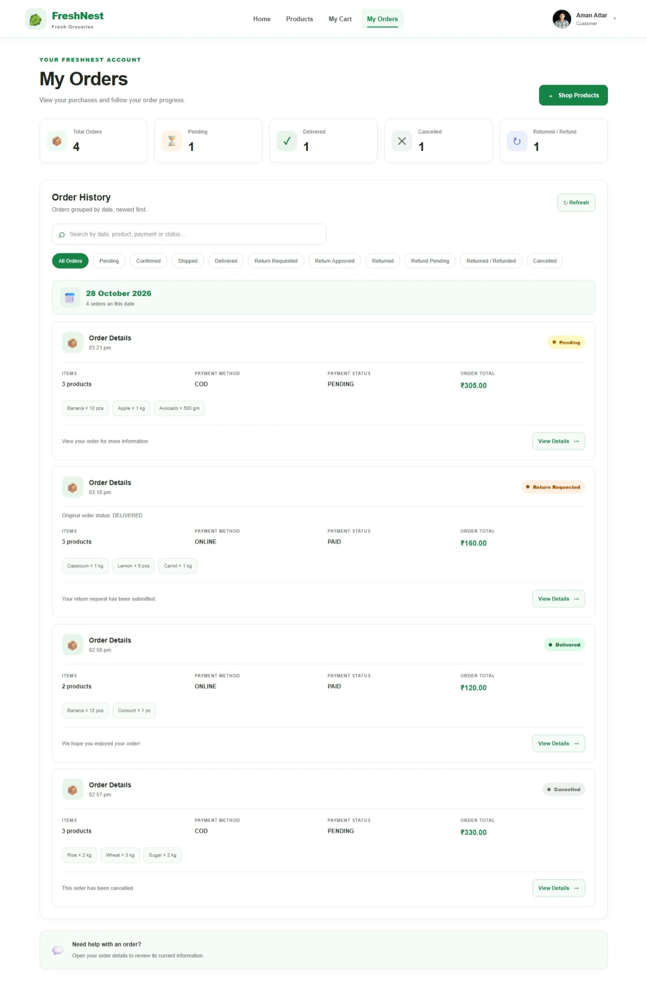

### 15. Customer Profile

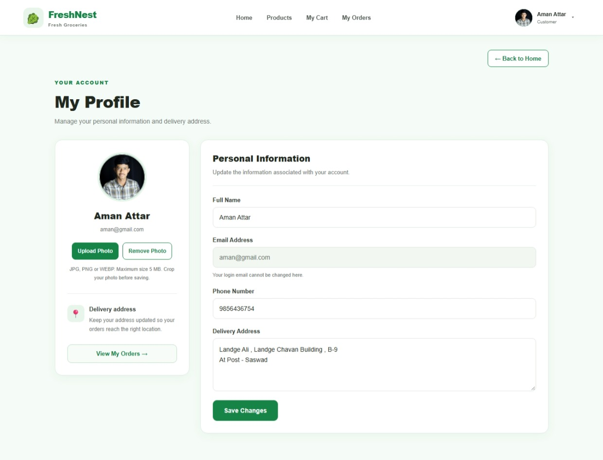

---

## 🔒 Security Notes

- Do not commit passwords, JWT secrets, or private environment files.
- Keep generated build folders and dependency folders out of Git where appropriate.
- Validate incoming data on the backend.
- Restrict admin operations to authorized administrators.
- Verify online payments using a trusted backend payment integration.
- Configure HTTPS and production security settings before deployment.

---

## 🚀 Future Enhancements

- Integration with a Trusted Online Payment Gateway
- Automatic Payment Verification
- Admin Notifications for Confirmed Payments
- Live Order Tracking
- Delivery Partner Module
- Email and SMS Notifications
- Inventory Management
- Product Ratings and Reviews
- Cloud Deployment
- Automated Testing
- Improved Mobile Responsiveness

---

## 👨‍💻 Author

**Aman Attar**

**Java Full Stack Developer**

**Technologies:** React.js | Java 21 | Spring Boot | Spring Security | JWT | MySQL

**GitHub:** [Manesh Vedpathak](https://github.com/amanattar14)

---

## ⭐ Support

If you find FreshNest interesting, consider starring the repository on GitHub.

Thank you for checking out **FreshNest – Grocery Delivery System!**